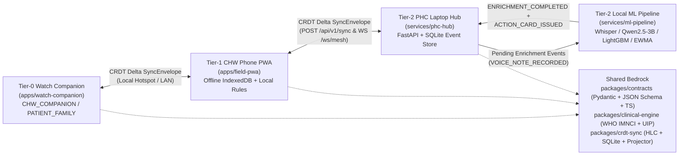

# Aarogya Mesh

**Autonomous, Offline-First, Capability-Proportional Edge Health Mesh** for Community Health Workers (CHWs / ASHAs) and dual-mode Patient-Family/CHW wearable companions.

Built for Hackathon Problem Statement #8 (Offline Health Assistant for Community Health Workers, with dual-mode Tier-0 Watch companion).

---

## Core Architectural Invariants

1. **Autonomous Node Kernel (Zero RPC Coupling)**: Every node — Tier-0 Watch, Tier-1 CHW Phone, and Tier-2 PHC Laptop Hub — operates 100% standalone indefinitely without internet or peer connectivity.
2. **Capability-Proportional Execution**: Each node inspects its `HardwareCapabilityManifest` (`tier`, `ram_mb`, `cpu_cores`, `battery_pct`, `has_npu`, `installed_models`) and routes workloads deterministically (`LOCAL_DETERMINISTIC`, `LOCAL_TINY_ML`, or `DEFER_TO_HUB`).
3. **Clinical Safety Floor**: Deterministic WHO IMNCI & India UIP / ASHA clinical rules (`packages/clinical-engine`) are the immutable hard floor. Local SLMs never own raw triage or override danger-sign escalations.
4. **Opportunistic HLC / CRDT Delta Sync**: Nodes exchange immutable append-only `CrdtEvent` logs ordered by Hybrid Logical Clocks (`packages/crdt-sync`) over local Hotspot / LAN / WebSocket whenever peers come into range, converging with strong eventual consistency.
5. **Zero-Bloat Edge Footprint**: Pure Python 3.12 (`uv`), FastAPI, SQLite, and lightweight CPU/NPU INT8 runtimes — zero PyTorch or CUDA dependencies.

---

## Architecture Overview



See [ARCHITECTURE.md](./ARCHITECTURE.md) for the full mechanism-first specification.

---

## 4-Module Ownership Map

| Track | Module Path | Owner | Status |
| --- | --- | --- | --- |
| **Track 1: Core Bedrock** | `packages/contracts`, `packages/clinical-engine`, `packages/crdt-sync`, `services/phc-hub` | Core / Gautham | Built & Verified |
| **Track 2: Field PWA** | `apps/field-pwa` | Teammate A | Ready to Claim |
| **Track 3: Watch Companion** | `apps/watch-companion` | Teammate B | Ready to Claim |
| **Track 4: Local ML Pipeline** | `services/ml-pipeline` | Teammate C | Ready to Claim |

See [TEAM_BOARD.md](./TEAM_BOARD.md) for exact interface contracts, entrypoints, and Definition of Done for each track.

---

## 2-Minute Local Quickstart

**Prerequisites**: Python `3.12+` and [`uv`](https://docs.astral.sh/uv/) installed.

```bash
# 1. Clone & install workspace dependencies
git clone https://github.com/Gauthampro7/aarogya-mesh.git
cd aarogya-mesh
uv sync

# 2. Run the full test suite across all workspace packages
make test

# 3. Verify lint, contracts, schemas, and tests together
make verify

# 4. Boot the Tier-2 PHC Hub locally (http://127.0.0.1:8000)
make run-hub
```

Once the Hub is running, inspect:
- `GET http://127.0.0.1:8000/health` — Hub liveness check
- `GET http://127.0.0.1:8000/manifest` — Live host `HardwareCapabilityManifest`
- `GET http://127.0.0.1:8000/docs` — Interactive OpenAPI docs

---

## Airplane-Mode Demo Script (3-Minute Verification)

Demonstrate full offline autonomy and opportunistic CRDT convergence without internet:

1. **Disconnect Network**: Enable Airplane Mode (or disconnect Wi-Fi) on the demo machine.
2. **Tier-0 / Tier-1 Standalone Triage**: Run deterministic IMNCI / danger-sign triage locally via `packages/clinical-engine` (or `POST /api/v1/triage`). Confirm `RED_EMERGENCY` triggers immediately on any single danger sign (`confidence = 1.0`, zero network required).
3. **Offline Divergence & Voice Note Queueing**: Simulate offline edits on Watch (`CHW_COMPANION` / `PATIENT_FAMILY`) and CHW Phone (`PATIENT_REGISTERED`, `TRIAGE_COMPLETED`, `VOICE_NOTE_RECORDED` with `enrichment_state = PENDING`).
4. **Opportunistic Peer Sync**: Reconnect over local Hotspot/LAN and send `SyncEnvelope` payloads to `POST /api/v1/sync`. Watch `packages/crdt-sync` merge events deterministically via HLC ordering `(wall_ms, logical, node_id)`.
5. **Deferred Tier-2 Enrichment & Sync Back**: Hub processes `GET /api/v1/enrichment/pending` via `services/ml-pipeline`, emits `ENRICHMENT_COMPLETED` + `ACTION_CARD_ISSUED`, and returns the delta `SyncEnvelope` so Watch and Phone converge to identical state (`pending_enrichments == 0`).

---

## Team Onboarding Guide

1. Read [TEAM_BOARD.md](./TEAM_BOARD.md) and claim your track (`apps/field-pwa`, `apps/watch-companion`, or `services/ml-pipeline`) using the **Module Claim** GitHub issue template.
2. Read [CONTRIBUTING.md](./CONTRIBUTING.md) for Trunk-Based Development, Conventional Commits, Contract-First rules, and zero-bloat hardware guidelines.
3. Read [ARCHITECTURE.md](./ARCHITECTURE.md) and your module's `MODULE_GUIDE.md` before creating your branch:
   ```bash
   git checkout -b feat/<module>-<short-slug>
   ```
4. Never edit files outside your assigned module without coordinating first (see [.github/CODEOWNERS](./.github/CODEOWNERS)).
5. Run `make verify` before opening a Pull Request.
