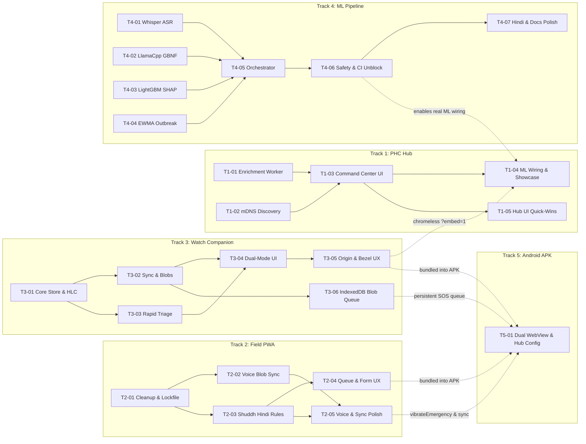

# Aarogya Mesh — Atomic Task-Prompt System

This directory holds **decoupled, single-slice starter prompts** for every track in **Aarogya Mesh**. Each file scopes exactly one small, independently testable PR (`<300 LOC`) so teammates and AI coding agents never build monoliths, never step on another track's files, and never drift from `packages/contracts/`.

---

## 1. Atomic Prompt Contract

Every prompt file under `prompts/track-*/` follows four rules:

1. **One Slice = One Issue = One Small PR (`<300 LOC`)**: Never combine two numbered files into a single branch or PR.
2. **Strict Path Isolation**: Every prompt declares explicit **Allowed Paths**, **Forbidden Paths**, and **CRITICAL INVARIANTS**. Do not edit files outside Allowed Paths. Need a contract or root dependency bump? Open a tiny standalone PR first (see [CONTRIBUTING.md](../CONTRIBUTING.md)).
3. **Claim Before Coding**:
   - Run `gh issue list` and `gh pr list` first.
   - Assign the slice's GitHub Issue to yourself, cut a fresh branch from `origin/main`, and open a **Draft PR** after your first small commit.
4. **Copy-Paste Ready**: Paste the fenced **Copy-Paste Starter Prompt** block directly into your AI coding agent (Antigravity, Cursor, Claude Code, Copilot, etc.) after pointing it at [AGENTS.md](../AGENTS.md). Every slice ends with `make verify` (plus track-specific checks).

---

## 2. Track & Slice Index

### Track 1 — Tier-2 PHC Hub (`services/phc-hub/`, Core Bedrock & UI Polish)
| Slice | File | Owner | Scope | Depends On |
| :--- | :--- | :--- | :--- | :--- |
| `T1-01` | [track-1-phc-hub/01-enrichment-worker-loop.md](./track-1-phc-hub/01-enrichment-worker-loop.md) | `@Gauthampro7` | Background enrichment worker polling `pending_enrichments`, `LocalBlobStore`, `ml-pipeline` protocols + deterministic safety floor *(merged)* | None |
| `T1-02` | [track-1-phc-hub/02-mdns-peer-discovery.md](./track-1-phc-hub/02-mdns-peer-discovery.md) | `@Gauthampro7` | `zeroconf` mDNS `_aarogya-mesh._tcp.local.` advertisement, `GET /api/v1/peers`, offline LAN/QR connect helper *(merged)* | None |
| `T1-03` | [track-1-phc-hub/03-phc-command-center-ui.md](./track-1-phc-hub/03-phc-command-center-ui.md) | `@Gauthampro7` | Offline Tier-2 PHC Command Center dashboard (`/` & `/showcase`) *(merged)* | `T1-01`, `T1-02` |
| `T1-04` | [track-1-phc-hub/04-ml-wiring-and-projector-stage.md](./track-1-phc-hub/04-ml-wiring-and-projector-stage.md) | `@Gauthampro7` | `/showcase` 1280×720 projector polish (tabbed Hub Brain, theme/lang persistence, reloads) + real ML backend wiring into `EnrichmentWorker` | Part 2: `T4-06` |
| `T1-05` | [track-1-phc-hub/05-command-center-ui-quickwins.md](./track-1-phc-hub/05-command-center-ui-quickwins.md) | `@Krishnanand-10` | `/` Command Center UI quick-wins (`patient_id → full_name`, `"+N more"`, auto-expand event log, `/api/v1/demo/scenarios` narrative card, `localStorage` `lang`/`theme`, compact header) | `T1-03` |

### Track 2 — Tier-1 CHW Field PWA (`apps/field-pwa/`, Srivastava `@Akarshx-x`)
| Slice | File | Owner | Scope | Issue / Depends On |
| :--- | :--- | :--- | :--- | :--- |
| `T2-01` | [track-2-field-pwa/01-cleanup-and-lockfile.md](./track-2-field-pwa/01-cleanup-and-lockfile.md) | `@Akarshx-x` | Remove unused legacy `src/sync_client.ts` & refresh cross-platform `package-lock.json` *(merged)* | Issue `#9` / None |
| `T2-02` | [track-2-field-pwa/02-voice-blob-sync.md](./track-2-field-pwa/02-voice-blob-sync.md) | `@Akarshx-x` | Upload IndexedDB `aarogya-field-audio` blobs to Hub `PUT /api/v1/blobs/{audio_blob_key}` with `HEAD` dedup *(merged)* | Issue `#11` / `T2-01` |
| `T2-03` | [track-2-field-pwa/03-hindi-rule-labels.md](./track-2-field-pwa/03-hindi-rule-labels.md) | `@Akarshx-x` | Pure *Shuddh Tatsama* Hindi labels for IMNCI/ANC/PNC rules enforced by `tests/ui/i18n.test.ts` *(merged)* | Issue `#10` / `T2-01` |
| `T2-04` | [track-2-field-pwa/04-patient-queue-and-form-ux.md](./track-2-field-pwa/04-patient-queue-and-form-ux.md) | `@Akarshx-x` | Synced patient roster + search + severity badges (`home.ts`), Years/Months toggle + conditional Pregnant (`register.ts`), triage scroll/maternal filter/danger confirm (`triage.ts`), saved checklist counter (`checklist.ts`) | `T2-03` |
| `T2-05` | [track-2-field-pwa/05-voice-recorder-and-sync-polish.md](./track-2-field-pwa/05-voice-recorder-and-sync-polish.md) | `@Akarshx-x` | Live `MM:SS` voice timer/re-record/`revokeObjectURL`/`!isSecureContext` (`voice.ts`), non-wiping sync banners + Action Card name join (`sync.ts`), Hindi `triage_result.ts` + `vibrateEmergency()` | `T2-02`, `T2-03` |

### Track 3 — Tier-0 Dual-Mode Watch Companion (`apps/watch-companion/`, Travis `@aril-travass`)
| Slice | File | Owner | Scope | Issue / Depends On |
| :--- | :--- | :--- | :--- | :--- |
| `T3-01` | [track-3-watch-companion/01-watch-core-store-hlc.md](./track-3-watch-companion/01-watch-core-store-hlc.md) | `@aril-travass` | Persistent local event store + monotonic `HlcClock` + `WatchMode` state in `src/core/` *(merged)* | Issue `#8` / None |
| `T3-02` | [track-3-watch-companion/02-watch-sync-and-blobs.md](./track-3-watch-companion/02-watch-sync-and-blobs.md) | `@aril-travass` | Peer `SyncEnvelope` exchange (`POST /api/v1/sync`) + `PUT/HEAD /api/v1/blobs/{blob_key}` audio upload *(merged)* | Issue `#8` / `T3-01` |
| `T3-03` | [track-3-watch-companion/03-watch-rapid-triage-and-reminders.md](./track-3-watch-companion/03-watch-rapid-triage-and-reminders.md) | `@aril-travass` | 1-tap deterministic red-flag screening emitting strict `TriageAssessment` + reminders *(merged)* | Issue `#8` / `T3-01` |
| `T3-04` | [track-3-watch-companion/04-watch-dual-mode-ui.md](./track-3-watch-companion/04-watch-dual-mode-ui.md) | `@aril-travass` | Circular `360x360` dual-mode UI (`CHW_COMPANION` / `PATIENT_FAMILY`), SOS voice recorder, *Shuddh Tatsama* Hindi, SW *(merged)* | Issue `#8` / `T3-02`, `T3-03` |
| `T3-05` | [track-3-watch-companion/05-origin-url-and-bezel-ux.md](./track-3-watch-companion/05-origin-url-and-bezel-ux.md) | `@aril-travass` | Auto-resolve `window.location.origin` Hub URL, in-place 1s timer update, `?embed=1` chromeless bezel, `⇄` cue, non-empty Text SOS guard, citizen-friendly `PATIENT_FAMILY` labels, circular chord padding | `T3-04` |
| `T3-06` | [track-3-watch-companion/06-indexeddb-sos-blob-queue.md](./track-3-watch-companion/06-indexeddb-sos-blob-queue.md) | `@aril-travass` | `IndexedDbWatchBlobQueue` + `MemoryWatchBlobQueue` Vitest fallback so pending SOS audio blobs survive tab reloads offline | Issue `#24` / `T3-02` |

### Track 4 — Tier-2 Local Edge ML Pipeline (`services/ml-pipeline/`, Krishna `@Krishnanand-10` & Core)
| Slice | File | Owner | Scope | Depends On |
| :--- | :--- | :--- | :--- | :--- |
| `T4-01` | [track-4-ml-pipeline/01-whisper-asr-backend.md](./track-4-ml-pipeline/01-whisper-asr-backend.md) | `@Krishnanand-10` | `WhisperVoiceTranscriber` (`faster-whisper`/`whisper.cpp` INT8 CPU, zero PyTorch/CUDA, stub fallback) | None |
| `T4-02` | [track-4-ml-pipeline/02-slm-gbnf-structurer.md](./track-4-ml-pipeline/02-slm-gbnf-structurer.md) | `@Krishnanand-10` | `LlamaCppSlmStructurer` (`Qwen2.5-3B` Q4 GGUF + GBNF JSON grammar; never overrides `TriageSeverity`) | None |
| `T4-03` | [track-4-ml-pipeline/03-lightgbm-shap-risk.md](./track-4-ml-pipeline/03-lightgbm-shap-risk.md) | `@Krishnanand-10` | `LightGbmRiskScorer` (CPU LightGBM + SHAP `TreeExplainer`, synthetic trainer, stub fallback) | None |
| `T4-04` | [track-4-ml-pipeline/04-ewma-outbreak-detector.md](./track-4-ml-pipeline/04-ewma-outbreak-detector.md) | `@Krishnanand-10` | `EwmaOutbreakDetector` (deterministic EWMA spatiotemporal surge detection per `(village_id, syndrome)`) | None |
| `T4-05` | [track-4-ml-pipeline/05-enrichment-orchestrator.md](./track-4-ml-pipeline/05-enrichment-orchestrator.md) | `@Krishnanand-10` | `EnrichmentPipeline` composing all 4 protocols + deterministic `evaluate_triage` hard safety floor | `T4-01`–`T4-04` |
| `T4-06` | [track-4-ml-pipeline/06-safety-floor-and-ci-unblock.md](./track-4-ml-pipeline/06-safety-floor-and-ci-unblock.md) | `@Gauthampro7` | Rescue & harden PR `#22` (rebase onto `main`, distinct IMNCI/Maternal flags + word-boundary regex, contextless maternal floor, CI risk fallback, remove `/tmp/pylibs`) | PR `#22` (`T4-01`–`T4-05`) |
| `T4-07` | [track-4-ml-pipeline/07-hindi-vocab-and-docs-polish.md](./track-4-ml-pipeline/07-hindi-vocab-and-docs-polish.md) | `@Krishnanand-10` | Pure *Shuddh Tatsama* Hindi polish (`आउटपुट` → `निर्गत`, `"तेज"` → `"तीव्र"`, nukta strip, Hindi `ActionCard` labels) & `MODULE_GUIDE.md` training/weights docs | `T4-06` |

### Track 5 — Native Android Shell (`apps/android-app/`, Core `@Gauthampro7`)
| Slice | File | Owner | Scope | Depends On |
| :--- | :--- | :--- | :--- | :--- |
| `T5-01` | [track-5-android-app/01-dual-webview-and-hub-config.md](./track-5-android-app/01-dual-webview-and-hub-config.md) | `@Gauthampro7` | Dual persistent `WebView` instances (`phoneWebView` / `watchWebView`), native "Set Hub URL" `AlertDialog` (stop clobbering `localStorage`), slim top bar, API 33+ `OnBackInvokedCallback` | None |

---

## 3. Parallel Execution Dependency DAG

All five tracks run **in parallel** because every cross-track boundary is locked to `packages/contracts/`. Solid arrows indicate strict ordering; dashed arrows indicate optional integration upgrades.

